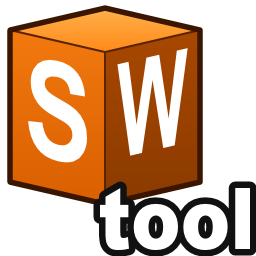

<p align="center"></p>

<h1 align="center">SW 工具箱</h1>

<p align="center">AI × SolidWorks 的桌面工具集：一键导出、URDF、标准件库、应力分析与拓扑优化、可制造性检查，还能让你的 AI 直接操控软件。</p>

> 这是第三方工具，和 Dassault Systèmes / SOLIDWORKS 没有关联。

## 功能

| 模块 | 能做什么 |
|---|---|
| 一键导出 | 零件、装配体、工程图批量导出 STEP / STL / 3MF / IGES / Parasolid / 钣金展开 DXF / PDF / DWG / DXF。导出在独立的后台 SolidWorks 里进行，不影响你正在用的 SolidWorks |
| URDF 导出 | 从配合识别关节，**没有配合时也能按零件几何推断**：同轴的轴和孔、轴承、电机输出轴、光轴和直线轴承、导轨。导出同时支持 ROS 1 和 ROS 2 的功能包，自动校验 |
| 标准件库 | 60 种零件（紧固件、轴承、直线运动、传动、型材、结构件、电机、电子），按 ISO / GB 尺寸表生成。**装配生成**：按中心距生成齿轮副（支持变位齿轮）、铝型材框架、同步带传动 |
| 应力分析 | 内置二次四面体有限元求解器，用代数多重网格做预条件；33 种材料，脆性材料用主应力判据；误差估计和自适应加密；**拓扑优化**（SIMP + 密度过滤 + Heaviside 投影），薄板自动按板件优化、只开穿透孔（碳板、铝板直接切） |
| 可制造性 | 8 种工艺：FDM、光固化、尼龙烧结（SLS / MJF）、金属打印（SLM）、CNC 铣削、板材切割（碳板雕刻 / 激光 / 水刀）、钣金、注塑。查悬垂、薄壁、倒扣、尖内角、折弯半径、孔边距、拔模、厚壁等，每个问题都给出修改建议，并估算用料、时间和费用 |
| 质量估算 | 拖入装配体，列出每种零件和数量，逐个或批量选材料（约 100 种：金属、碳纤维、塑料、FDM / 光固化 / 尼龙烧结 / 金属打印、木材泡沫），外购件填实测质量；算总质量、重心、按材料的小计，导出 CSV |
| 实验报告 | 一键生成 Word 报告（中文论文排版、三线表、方法描述、GB/T 7714 参考文献）、300 dpi 图片、CSV 原始数据 |
| 工作区 | 查同名文件（SolidWorks 按文件名认文档的经典坑）、检查装配体引用、版本历史和恢复、崩溃找回 |
| AI 建模提示词 | 照片 → 建模步骤 / SolidWorks 宏，适用于 Claude Skill、ChatGPT 和各种通用 AI |
| AI 控制接口 | MCP（Claude、Cursor、VS Code、Cherry Studio、Codex CLI、Gemini CLI……）、HTTP 版 MCP、OpenAPI、OpenAI 函数调用；`swkit-cli agent` 可以接入任何兼容 OpenAI 接口的大模型（GPT、DeepSeek、通义、Kimi、智谱、豆包、本机 Ollama） |

求解器用拉杆、悬臂梁、带孔板、扭转轴、自重悬臂梁的理论解验证过，误差在 0.04%–2% 之间（`swkit-cli fea bench`）。

## 下载和使用

到 [Releases](../../releases) 下载：

- **`SW工具箱-v版本-安装程序.exe`（推荐）**：双击安装，不需要管理员权限，会建好开始菜单和桌面快捷方式，卸载在「设置 → 应用」里。
- **`SW工具箱-v版本.zip`（绿色版）**：解压到任意位置，双击 `SwKit.exe`。

两个文件都没有数字签名，第一次运行时 Windows 可能提示「已保护你的电脑」，点「更多信息 → 仍要运行」即可。

从 v0.7 开始，软件左下角可以**检查更新、一键更新**（自动下载、核对 SHA-256、安装、重新打开），不用再来这里下载。v0.6 及更早的版本需要手动装一次 v0.7。

需要：
- Windows 10 / 11（自带 .NET Framework 4.8）
- SolidWorks 2023 及以上：导出、URDF、标准件、读取 .sldprt 时用到。应力分析和可制造性检查读 STEP / STL 时不需要 SolidWorks。

详细用法见 [swkit/使用说明.md](swkit/使用说明.md)。

## 从源码编译

1. 安装 Visual Studio 2019+ 或 Build Tools，用它提供的 Roslyn C# 编译器。
2. 本机装好 SolidWorks。编译时从安装目录的 `api\redist` 读接口定义，并把它嵌入 exe。
3. 把 [Gmsh](https://gmsh.info) 4.15.2 的 Windows 版 `gmsh.exe` 放到 `swkit/tools/gmsh/`。Gmsh 是 GPL 开源软件，许可证在同一个文件夹里；仓库里不放这个 86 MB 的程序，Release 压缩包里有。
4. 编译和打包：

```powershell
cd swkit
powershell -ExecutionPolicy Bypass -File .\build.ps1     # 生成 bin\SwKit.exe 和 bin\swkit-cli.exe
powershell -ExecutionPolicy Bypass -File .\release.ps1   # 打包 release\SW工具箱-v版本.zip
```

维护说明、测试命令和设计取舍见 [swkit/README.md](swkit/README.md)；提示词包见 [prompt-kit/README.md](prompt-kit/README.md)。

## 目录

```
swkit/        桌面程序（C# / WPF，.NET Framework 4.8）和命令行版 swkit-cli
  src/Core/   导出、URDF、标准件、有限元（求解器、多重网格、拓扑优化）、可制造性、报告、工作区
  src/App/    界面
  src/Cli/    命令行、MCP 服务器、通用 AI 代理
  tools/      Gmsh（需自行放入）、示例零件、可制造性测试件、图标生成脚本
prompt-kit/   AI 建模提示词包（Claude Skill / ChatGPT / 通用提示词）
```
